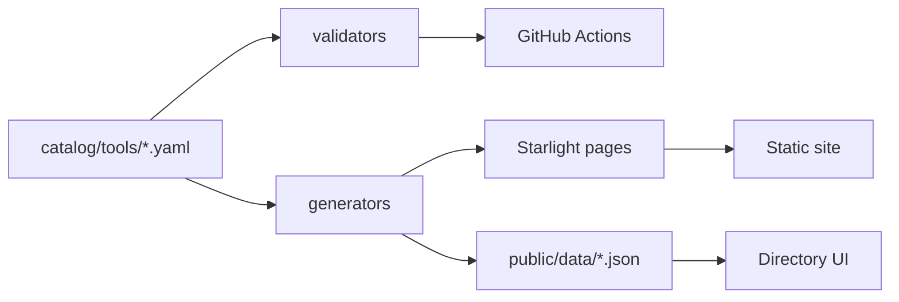

## Principles

- **YAML is canonical** for tools, stacks, workflows.
- **Zod schemas** in `@ocs/schema` enforce structure.
- **Generators** produce docs and JSON exports; do not hand-edit generated files.
- **Future Supabase/API** should mirror this model, not replace it.

## Schema version

`schema_version: "1.0.0"` on all catalog documents.
